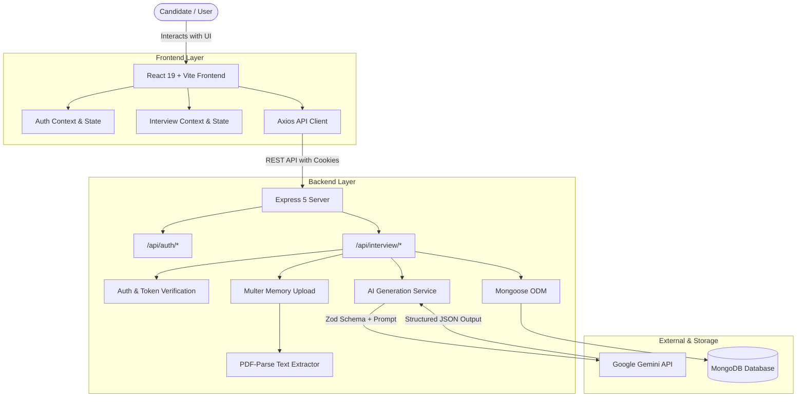

# 🎯 Interview-AI

> **An AI-powered technical and behavioral interview preparation platform that bridges the gap between your resume and your dream job description.**

[](https://nodejs.org/)
[](https://expressjs.com/)
[](https://react.dev/)
[](https://vitejs.dev/)
[](https://www.mongodb.com/)
[](https://ai.google.dev/)
[](https://opensource.org/licenses/ISC)

---

## 📌 Table of Contents

- [Overview](#-overview)
- [Key Features](#-key-features)
- [System Architecture](#-system-architecture)
- [Tech Stack](#-tech-stack)
- [Project Directory Structure](#-project-directory-structure)
- [Prerequisites](#-prerequisites)
- [Getting Started](#-getting-started)
  - [1. Clone Repository](#1-clone-repository)
  - [2. Backend Setup](#2-backend-setup)
  - [3. Frontend Setup](#3-frontend-setup)
- [Environment Configuration](#-environment-configuration)
- [API Reference](#-api-reference)
  - [Authentication Endpoints](#authentication-endpoints)
  - [Interview Endpoints](#interview-endpoints)
- [AI Schema & Structured Output](#-ai-schema--structured-output)
- [Roadmap](#-roadmap)
- [Contributing](#-contributing)
- [License](#-license)

---

## 💡 Overview

Preparing for technical interviews often involves generic problem sets and disjointed study materials that don't match the specific role or the candidate's actual background.

**Interview-AI** transforms interview preparation into a personalized, role-targeted experience:
1. **Upload or paste your Resume** alongside an optional self-description.
2. **Provide the target Job Description** you are interviewing for.
3. **Receive a comprehensive, structured strategy report**:
   - Objective compatibility match score (0–100%)
   - Highly targeted technical questions with interviewer intentions and model answers
   - STAR-format behavioral questions designed around company expectations
   - Identified skill gaps categorized by impact severity (`low`, `medium`, `high`)
   - A personalized 15+ day, step-by-step preparation plan with daily tasks and progress tracking

---

## ✨ Key Features

- **📄 Intelligent Resume Parsing (PDF & Text)**  
  Direct in-memory PDF parsing using `pdf-parse` and `multer`. Supports uploaded PDF files or raw text input with zero disk footprint.

- **📑 AI-Tailored ATS Resume Generation (PDF Export)**  
  Generates a tailored, ATS-compliant HTML resume using Google Gemini specifically matching the target job description, rendered and converted to a downloadable PDF via Puppeteer in-memory.

- **🎯 Role Fit & Match Scoring**  
  Calculates an instant compatibility score (0–100%) between the candidate's verified background and the job requirements.

- **🧠 Context-Aware Technical Questions**  
  Generates targeted technical interview questions extracted from the specific intersection of candidate projects, tech stack, and employer needs. Each question includes:
  - **Question**: The exact technical prompt.
  - **Interviewer's Intention**: What core competency the interviewer is assessing.
  - **Model Answer Strategy**: How to formulate the response, key trade-offs, and architecture/algorithmic points.

- **💬 Behavioral & Cultural Scenarios**  
  Scenario-based behavioral questions paired with guidance on how to structure answers using the STAR (Situation, Task, Action, Result) method.

- **🔍 Skill Gap Analysis with Severity Levels**  
  Identifies missing or weak skills relative to the job posting and ranks them by severity (`low`, `medium`, `high`) to help prioritize study time.

- **📅 15+ Day Interactive Preparation Roadmap**  
  A structured, day-by-day preparation schedule with daily themes (e.g., Data Structures, System Design, Concurrency, Mock Rounds) and granular task checklists with completion tracking.

- **🔐 Robust Authentication & Session Management**  
  Secure authentication using JWT cookies, Bcrypt password hashing, and server-side token blacklisting to ensure clean, tamper-proof logouts.

- **📂 Report History & Persistence**  
  Save and access all previously generated interview reports from MongoDB. Easily compare readiness across multiple companies and roles.

- **🎨 Modern Developer-Focused UI**  
  Built with React 19, SCSS, responsive layouts, expandable question accordions, one-click answer copying, and progress tracking.

---

## 🏗️ System Architecture



---

## 🛠️ Tech Stack

### Frontend
| Technology | Description |
| :--- | :--- |
| **React 19** | Modern component-based UI library |
| **Vite** | Next-generation fast frontend tooling and dev server |
| **React Router v8** | Declarative client-side routing & route guards |
| **SASS / SCSS** | Modular styling with variables, nested rules, and mixins |
| **Axios** | Promise-based HTTP client with cookie credentials handling |

### Backend
| Technology | Description |
| :--- | :--- |
| **Node.js** | Server-side JavaScript runtime environment |
| **Express 5** | Minimalist web application framework |
| **MongoDB & Mongoose 9** | NoSQL document database with schema modeling |
| **Google GenAI SDK** (`@google/genai`) | Official client SDK for Google Gemini models |
| **Zod** | TypeScript/JavaScript schema declaration and validation library |
| **PDF-Parse** | Pure JavaScript library for extracting text from PDF files |
| **Multer** | Middleware for handling `multipart/form-data` in-memory |
| **JSON Web Tokens (JWT)** | Stateless authentication tokens stored in HTTP-only cookies |
| **Bcryptjs** | Password hashing for user authentication |
| **Cookie-Parser** | Parse HTTP request cookies |
| **CORS** | Cross-Origin Resource Sharing configuration |

---

## 📁 Project Directory Structure

```plaintext
Interview-AI/
├── Backend/
│   ├── src/
│   │   ├── config/
│   │   │   └── database.js              # MongoDB connection via Mongoose
│   │   ├── controllers/
│   │   │   ├── auth.controller.js       # Register, login, logout, getMe handlers
│   │   │   └── interview.controller.js  # Generate report, get report by ID, list reports
│   │   ├── middlewares/
│   │   │   └── auth.middleware.js       # JWT validation & token blacklist verification
│   │   ├── models/
│   │   │   ├── user.model.js            # User credentials & profile schema
│   │   │   ├── interviewReport.model.js # Complete interview report schema
│   │   │   └── blacklist.model.js       # Revoked JWT tokens schema
│   │   ├── routes/
│   │   │   ├── auth.routes.js           # /api/auth routes
│   │   │   └── interview.routes.js      # /api/interview routes
│   │   ├── services/
│   │   │   └── ai.service.js            # Gemini API integration & Zod structured output
│   │   └── app.js                       # Express app configuration & middlewares
│   ├── .env.example                     # Sample environment variable template
│   ├── package.json                     # Backend dependencies & scripts
│   └── server.js                        # Server entry point & DB connection trigger
│
├── Frontend/
│   ├── src/
│   │   ├── features/
│   │   │   ├── auth/                    # Authentication feature module
│   │   │   │   ├── components/Protected.jsx
│   │   │   │   ├── hooks/useAuth.js
│   │   │   │   ├── pages/Login.jsx & Register.jsx
│   │   │   │   ├── services/auth.api.js
│   │   │   │   └── auth.context.jsx
│   │   │   └── interview/               # Interview feature module
│   │   │       ├── components/          # Navbar, Hero, JD Section, Profile, Footer
│   │   │       ├── pages/Home.jsx & Interview.jsx
│   │   │       ├── services/interview.api.js
│   │   │       ├── style/               # Component SCSS stylesheets
│   │   │       └── interview.context.jsx
│   │   ├── app.routes.jsx               # Client-side route configuration
│   │   ├── App.jsx                      # App root with Context Providers
│   │   ├── main.jsx                     # Vite React entry point
│   │   └── style.scss                   # Global stylesheets
│   ├── index.html                       # HTML template
│   ├── package.json                     # Frontend dependencies & scripts
│   └── vite.config.js                   # Vite bundler configuration
│
├── .gitignore                           # Git ignore rules
└── README.md                            # Project documentation
```

---

## 📋 Prerequisites

Before running the project locally, ensure you have the following installed:

- **Node.js**: v18.0.0 or higher ([Download Node.js](https://nodejs.org/))
- **npm**: v9.0.0 or higher (packaged with Node.js)
- **MongoDB**: A running local MongoDB instance (`mongodb://localhost:27017`) or a free [MongoDB Atlas](https://www.mongodb.com/atlas) cluster URI.
- **Google Gemini API Key**: Obtain a free API key from [Google AI Studio](https://aistudio.google.com/).

---

## 🚀 Getting Started

### 1. Clone Repository

```bash
git clone https://github.com/your-username/Interview-AI.git
cd Interview-AI
```

---

### 2. Backend Setup

1. **Navigate to the Backend directory:**
   ```bash
   cd Backend
   ```

2. **Install dependencies:**
   ```bash
   npm install
   ```

3. **Configure Environment Variables:**
   Create a `.env` file in the `Backend/` folder by copying `.env.example`:
   ```bash
   cp .env.example .env
   ```
   Open `.env` and fill in your credentials:
   ```env
   PORT=3000
   MONGO_URI=mongodb://localhost:27017/interview-ai
   JWT_SECRET=your_super_secret_jwt_key
   GOOGLE_GENAI_API_KEY=your_gemini_api_key_here
   ```

4. **Start the backend development server:**
   ```bash
   npm run dev
   ```
   The backend server will run on `http://localhost:3000`.

---

### 3. Frontend Setup

1. **Open a new terminal and navigate to the Frontend directory:**
   ```bash
   cd Frontend
   ```

2. **Install dependencies:**
   ```bash
   npm install
   ```

3. **Start the Vite development server:**
   ```bash
   npm run dev
   ```
   The application will be accessible at `http://localhost:5173`.

---

## ⚙️ Environment Configuration

### Backend (`Backend/.env`)

| Variable | Description | Example / Default |
| :--- | :--- | :--- |
| `PORT` | Port for the Express backend server | `3000` |
| `MONGO_URI` | Connection URI for MongoDB | `mongodb://localhost:27017/interview-ai` |
| `JWT_SECRET` | Secret key used to sign and verify JWT tokens | `your_secret_key` |
| `GOOGLE_GENAI_API_KEY` | API key for Google Gemini model generation | `AIzaSy...` |

---

## 📡 API Reference

### Authentication Endpoints

Base URL: `/api/auth`

#### 1. Register User
- **Method:** `POST`
- **Endpoint:** `/api/auth/register`
- **Access:** Public
- **Request Body (JSON):**
  ```json
  {
    "username": "rahulsharma",
    "email": "rahul@example.com",
    "password": "SecurePassword123!"
  }
  ```
- **Response (`201 Created`):**
  ```json
  {
    "message": "User registered successfully",
    "user": {
      "id": "66d3a8e9f1a23b456c789012",
      "username": "rahulsharma",
      "email": "rahul@example.com"
    }
  }
  ```

#### 2. Login User
- **Method:** `POST`
- **Endpoint:** `/api/auth/login`
- **Access:** Public
- **Request Body (JSON):**
  ```json
  {
    "email": "rahul@example.com",
    "password": "SecurePassword123!"
  }
  ```
- **Response (`200 OK`):** Sets HTTP-only authentication cookie `token`.

#### 3. Current User Profile
- **Method:** `GET`
- **Endpoint:** `/api/auth/get-me`
- **Access:** Private (Requires valid auth cookie)
- **Response (`200 OK`):**
  ```json
  {
    "user": {
      "_id": "66d3a8e9f1a23b456c789012",
      "username": "rahulsharma",
      "email": "rahul@example.com"
    }
  }
  ```

#### 4. Logout User
- **Method:** `GET`
- **Endpoint:** `/api/auth/logout`
- **Access:** Public
- **Response (`200 OK`):** Adds the current token to blacklist collection and clears cookie.

---

### Interview Endpoints

Base URL: `/api/interview`

#### 1. Generate Interview Report
- **Method:** `POST`
- **Endpoint:** `/api/interview/`
- **Access:** Private
- **Content-Type:** `multipart/form-data` or `application/json`
- **Payload:**
  - `resume` *(File: PDF format)* or `resume` *(string)*
  - `jobDescription` *(string, required)*: The target job posting description
  - `selfDescription` *(string, optional)*: Additional context or background
- **Response (`201 Created`):**
  ```json
  {
    "message": "Interview report generated successfully",
    "interviewReport": {
      "_id": "66d3b4e9f1a23b456c789099",
      "title": "Software Engineer – Backend",
      "matchScore": 88,
      "technicalQuestions": [
        {
          "question": "Can you explain the Event Loop in Node.js and how it handles asynchronous I/O?",
          "intention": "Assess candidate's deep understanding of the Node.js runtime and asynchronous non-blocking model.",
          "answer": "Explain the single-threaded event loop, libuv thread pool, phases of event loop, and callback queue execution."
        }
      ],
      "behavioralQuestions": [
        {
          "question": "Tell me about a time you optimized a critical bottleneck under a tight deadline.",
          "intention": "Evaluate problem-solving methodology, composure under pressure, and communication.",
          "answer": "Use STAR format: Situation at TechNova, Task to reduce response times, Action using query indexing, Result of 40% latency drop."
        }
      ],
      "skillGaps": [
        {
          "skill": "Docker & Containerization",
          "severity": "medium"
        }
      ],
      "preparationPlan": [
        {
          "day": 1,
          "focus": "Data Structures & Algorithm Review",
          "tasks": [
            "Solve Top 5 Array & Two Pointer problems on LeetCode",
            "Review Big-O time and space complexity trade-offs"
          ]
        }
      ],
      "createdAt": "2026-09-08T12:00:00.000Z"
    }
  }
  ```

#### 2. Get All User Reports
- **Method:** `GET`
- **Endpoint:** `/api/interview/`
- **Access:** Private
- **Response (`200 OK`):** Returns summarized list of all past reports for the authenticated user.

#### 3. Get Report by ID
- **Method:** `GET`
- **Endpoint:** `/api/interview/report/:interviewId`
- **Access:** Private
- **Response (`200 OK`):** Returns full interview report details matching `interviewId`.

#### 4. Generate Tailored ATS Resume PDF
- **Method:** `POST`
- **Endpoint:** `/api/interview/resume/pdf/:interviewReportId`
- **Access:** Private
- **Response (`200 OK`):** Returns binary PDF buffer attachment (`resume_<interviewReportId>.pdf`) tailored for the job description.

---

## 🤖 AI Schema & Structured Output

Interview-AI utilizes **Google Gemini** (`gemini-3-flash-preview` or `gemini-2.5-flash`) with **Zod Schema Enforcement** to guarantee strict JSON output format:

```javascript
const interviewReportSchema = z.object({
  title: z.string().describe("The job title for which the report is generated"),
  matchScore: z.number().min(0).max(100).describe("0-100 compatibility score"),
  technicalQuestions: z.array(z.object({
    question: z.string(),
    intention: z.string(),
    answer: z.string()
  })),
  behavioralQuestions: z.array(z.object({
    question: z.string(),
    intention: z.string(),
    answer: z.string()
  })),
  skillGaps: z.array(z.object({
    skill: z.string(),
    severity: z.enum(["low", "medium", "high"])
  })),
  preparationPlan: z.array(z.object({
    day: z.number(),
    focus: z.string(),
    tasks: z.array(z.string())
  }))
});
```

Benefits of this schema-driven approach:
- Eliminates JSON parsing errors or unpredictable markdown backticks from LLM responses.
- Enforces strict data types for numeric scores, severity enums, and nested arrays.
- Guarantees complete data synchronization between the database model and the frontend UI.

---

## 🗺️ Roadmap

- [x] User Authentication & Session Security (JWT + Cookies + Token Blacklist)
- [x] PDF Resume Extraction via `pdf-parse` & Multer
- [x] Structured AI Report Generation (Gemini + Zod)
- [x] Tailored ATS-Friendly Resume PDF Generator via Puppeteer & Gemini
- [x] Interactive Report Dashboard with Technical/Behavioral Tabs & Accordions
- [x] Dynamic Preparation Roadmap Timeline
- [ ] **AI Voice Mock Interview**: Real-time speech-to-text and simulated AI interviewer audio questions
- [ ] **Live Code Sandbox**: Code editor with test case execution for technical interview challenges

---

## 🤝 Contributing

Contributions are welcome! If you'd like to improve Interview-AI:

1. Fork the repository.
2. Create a new branch: `git checkout -b feature/your-feature-name`
3. Commit your changes: `git commit -m "feat: add your feature"`
4. Push to the branch: `git push origin feature/your-feature-name`
5. Open a Pull Request.

---

## 📄 License

This project is open-source and licensed under the [ISC License](LICENSE).

